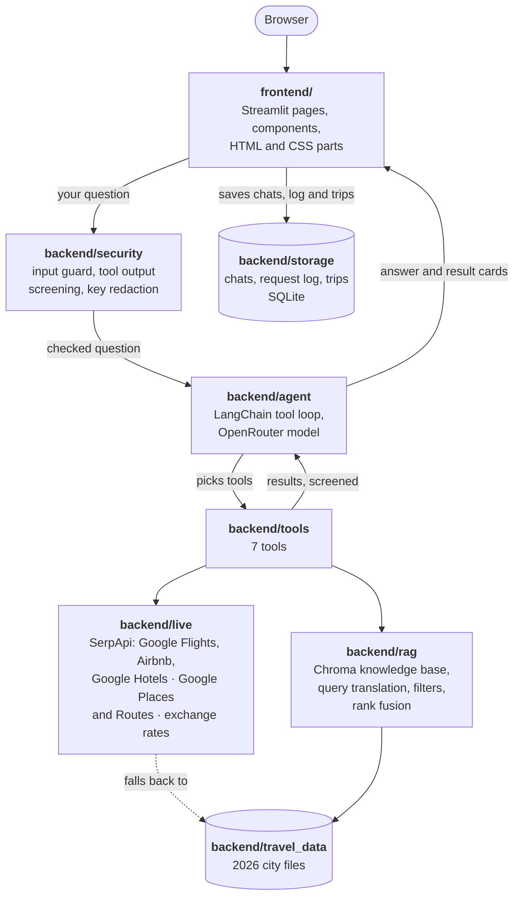

# TripMate ✈️ travel planner chatbot

[](https://github.com/Anusha-3109/Travel-planner-bot/actions/workflows/tests.yml)

TripMate plans day-by-day trips anywhere in the world: flights, a place to stay, restaurants for each meal, things to see and how to get from the airport, all costed against your budget in your currency. It searches **live** flights, Airbnb and hotel prices, restaurants and public transport, and falls back to 2026 snapshot data when live data isn't available. It is built with LangChain, OpenRouter (Claude Haiku 5.5 by default) and Streamlit, and combines advanced RAG with tool calling.

The Sprint 2 task description is in [`125.md`](125.md).

## Contents

- [What you can do](#what-you-can-do)
- [How it works](#how-it-works)
- [Course requirements](#course-requirements)
- [Data sources](#data-sources)
- [Setup and run](#setup-and-run)
- [Evaluation](#evaluation)
- [Costs and limits](#costs-and-limits)
- [Security](#security)
- [Tests](#tests)
- [Project structure](#project-structure)
- [Known limitations and ideas for improvement](#known-limitations-and-ideas-for-improvement)
- [Attribution](#attribution)

## What you can do

| Page | What it's for |
|---|---|
| **Chat** | Ask in **Plan** mode for a full trip (flights, stay, meals, transport, cost and checks) or in **Explore** mode for places, food and getting around (no flight or stay searches). Results appear as cards under the answer; **Save as trip** keeps a costed plan. The trip form opens from the chat page. |
| **My trips** | Saved trips, each with a day-by-day timeline, the route on a map, the stays found (with booking links) and places to discover. |
| **Dashboard** | Requests, answer times, tokens, cost, tool calls, refused questions, errors and live searches per day, from the request log. |
| **Benchmarks** | The evaluation results: retrieval strategies, RAGAS answer scores per model and trip-plan pass rates. |
| **How it answers** | How a question becomes an answer, the tools, the knowledge base (with a free search box), data sources, costing rules and safety checks. |
| **Settings** | The answer model (Claude Haiku 5.5, OpenAI GPT-6 Luna or Google Gemini 3.7 Flash), currency, chat export, deleting history, rebuilding the knowledge base. |

Chats are saved on your computer (`.history/`), so a refresh or restart keeps them. Example questions:

- *"Plan a 3-night trip from Paris to Barcelona from 20 November for 2 people with a budget of 1,200."*
- *"Flights from New York to Tokyo on 22 November."*
- *"Find an Airbnb in Rome from 10 to 14 November for 2 people."* (add *"in a table"* for a table)
- *"Museums for kids in Chicago."* (Explore mode)

## How it works

### The big picture



The **frontend** only draws the pages and passes your input on; the **backend** holds all the logic and has no Streamlit code, so it can be tested and evaluated on its own.

### From question to answer

1. **Input guard.** Your message is checked for length, control characters and prompt-injection patterns before any model sees it. Refused messages are logged with their reason.
2. **Agent.** The model reads the question with today's date, your currency and the mode, and decides which tools to call (up to 10 steps). Explore mode only offers the place, restaurant and transport tools.
3. **Tools.** Live data first (dates from today on). If a search fails, the date is in the past or a key is missing, the tool falls back to the 2026 snapshot data and says so.
4. **Screening.** Text from outside sources (listing names, place descriptions) is screened for injected instructions before the model reads it.
5. **Cost and checks.** For a full plan the agent must call `calculate_trip_cost` and `check_constraints` with the ids of the results it chose, so totals use the prices the services returned, never numbers the model typed. If it skips them, it is sent back once to use them.
6. **Answer.** The model writes the answer (best picks as a list, or full tables if you ask); the app draws every result as a card from the tools' own data, and logs the request (time, tokens, cost, tools, searches).

### The agent

- `backend/agent/llm.py`: LangChain's `ChatOpenAI` pointed at OpenRouter, plus each reply's tokens and cost (OpenRouter's own figure, or the model's price list).
- `backend/agent/agent.py`: the hand-written tool loop, the system prompt (data sources, planning rules, answer formats), the cost guard and clear error messages.
- `backend/agent/trip_request.py`: the trip request text the trip form sends, also used by the evaluation.

### The 7 tools

| Tool | File | What it does |
|---|---|---|
| `search_flights` | `backend/tools/transport.py` | Live Google Flights for a date, grouped by airline, cheapest first, with flight numbers, times, stops and price per person (and the group total). Without live data: an estimated flight time without a price. Also gives self-driving and taxi options from live Google Routes (IRS-rate car cost in the US), or estimated from the distance |
| `search_accommodations` | `backend/tools/places.py` | Live Airbnb (default) or Google Hotels stays for the dates and guests, with nightly and total prices, ratings, free cancellation and booking links. Falls back to the 2026 snapshot stays with exact filters; OpenStreetMap stays have no prices |
| `search_restaurants` | `backend/tools/places.py` | Live Google Places restaurants by city and cuisine, with price range per person (local currency and yours), rating, opening hours and a Maps link |
| `get_local_transport` | `backend/tools/local_transport.py` | Live Google Routes public transport for the travel day and time (lines, stops, times, fares where published) and driving time, with an estimated cost per car in the US |
| `search_destination_options` | `backend/tools/destinations.py` | RAG search over the knowledge base for open questions such as "museums for kids in Chicago" |
| `calculate_trip_cost` | `backend/tools/planning.py` | Costs a day-by-day plan from live ids or snapshot names, including airport transfers, in any currency, marking each line live, snapshot or estimate and listing unpriced items |
| `check_constraints` | `backend/tools/planning.py` | Checks a plan: budget, house rule, room type, cuisines, banned transport, items that exist, no repeats, minimum nights, a stay every night and stays that fit the group |

### The knowledge base (RAG)

- **Documents:** over 50,000 places in 245 cities, one document per attraction, restaurant or stay (records are short, so each stays whole), with category, city, country, price and rating as metadata (`backend/rag/ingest.py`).
- **Embeddings:** local all-MiniLM-L6-v2 in Chroma, cosine similarity, no API key (`backend/rag/vectorstore.py`). The app adds new places by itself at startup.
- **Retrieval** (`backend/rag/retriever.py`): the model rewrites the question into 2–3 focused searches (query translation), extracts `category` and `city` filters (structured retrieval), and the results are merged with reciprocal rank fusion. The places are shown under **Sources** in the answer.

### Saved data

`backend/storage/history.py` keeps chats (messages with their tool results, model, currency, mode, bookmark), the request log behind the dashboard, and saved trips, in `.history/chats.sqlite3` (git-ignored). `backend/storage/trips.py` builds a trip from a costed plan's tool results only: the plan, prices, checks, flight times, transit steps, stay links and ratings.

## Course requirements

| Requirement | How TripMate covers it |
|---|---|
| Knowledge base | Over 50,000 places, all from 2026, for 245 cities: OpenStreetMap restaurants and attractions everywhere, Inside Airbnb stays with prices for 50 cities and OpenStreetMap hotels without prices for the other 195 US cities (`backend/travel_data/catalog.py`) |
| Embeddings and similarity search | Chroma with local all-MiniLM-L6-v2 embeddings (cosine similarity) |
| Chunking | One chunk per place, with metadata for filtering |
| Query translation | The model rewrites each question into 2–3 focused searches (multi-query) |
| Structured retrieval | Category and city filters extracted by the model; reciprocal rank fusion over all searches |
| Tool calling | 7 tools, see [The 7 tools](#the-7-tools) |
| Domain specialisation | A travel-planning system prompt with rules for live versus snapshot data, budgets, citations and answer formats |
| Security | See [Security](#security) |
| LangChain + OpenRouter | `ChatOpenAI` pointed at OpenRouter, LangChain tools and messages, a hand-written tool loop |
| Error handling and validation | Clear messages for missing or rejected keys, rate limits, timeouts and failing services; every tool input is validated |
| User interface | Streamlit pages (chat, My trips, dashboard, benchmarks, How it answers), result cards, a Settings pop-up, saved history, and HTML and CSS parts in `frontend/html/` |

**Optional tasks implemented**

- *Easy:* conversation history and export (Markdown and JSON), source citations, an interactive help page (How it answers, with a search box).
- *Medium:* real-time data (live flights, stays, restaurants and transport), prompt-injection protection (user messages and tool results), rate limiting and API key management, token usage and cost display, multi-model support, visualisation of tool call results (result cards, trip timeline and map), logging and monitoring (request log and dashboard).
- *Hard:* an evaluation of the RAG system with RAGAS and retrieval metrics, plus A/B testing of four retrieval strategies (see [Evaluation](#evaluation)). The scripts are in place; the results are added to the Benchmarks page once the evaluation has run.

## Data sources

**Live** (dates from today, any city; cached so repeat questions are free)

| Data | Source | Cached for |
|---|---|---|
| Flights | Google Flights via [SerpApi](https://serpapi.com) | 1 hour |
| Airbnb and hotel stays | Airbnb and Google Hotels via SerpApi | 6 hours |
| Restaurants | [Google Places API (New)](https://developers.google.com/maps/documentation/places/web-service) | 24 hours |
| Public transport and driving | [Google Routes API](https://developers.google.com/maps/documentation/routes) | 24 hours |
| Exchange rates | [ExchangeRate-API](https://www.exchangerate-api.com) open endpoint, with the [European Central Bank](https://www.ecb.europa.eu/stats/policy_and_exchange_rates/euro_reference_exchange_rates/html/index.en.html) as backup | 12 hours |

**Snapshot** (fallback, past dates and the knowledge base)

| Data | Source | Date | Licence |
|---|---|---|---|
| Stays in 50 cities (34 US areas, 16 in Europe and Asia) | [Inside Airbnb](https://insideairbnb.com) | September 2026 | CC BY 4.0 |
| Restaurants and attractions in all 245 cities | [OpenStreetMap](https://www.openstreetmap.org/copyright) via the Overpass API | October 2026 | ODbL |
| Hotels, motels and guest houses (no prices) in the other 195 US cities | OpenStreetMap via the Overpass API | October 2026 | ODbL |
| Airports (for flight searches) | [OurAirports](https://ourairports.com/data/) | October 2026 | Public domain |
| The list of the 195 smaller US cities, and the evaluation questions | [TravelPlanner](https://huggingface.co/datasets/osunlp/TravelPlanner) (Xie et al., 2024) | 2024 | CC BY 4.0 |
| US driving cost | [IRS standard mileage rate](https://www.irs.gov/tax-professionals/standard-mileage-rates) ($0.725 a mile) with Google Routes distances | 2026 | Public |

The European and Asian cities are London, Paris, Rome, Barcelona, Madrid, Amsterdam, Berlin, Vienna, Prague, Lisbon, Athens, Istanbul, Tokyo, Bangkok, Singapore and Hong Kong. The US areas with Inside Airbnb data are Albany, Asheville, Austin, Boston, Bozeman, Cambridge, Chicago, Columbus, Dallas, Denver, Fort Lauderdale, Fort Worth, Honolulu, Jersey City, Las Vegas, Los Angeles, Minneapolis, Nashville, New Orleans, New York, Newark, Oakland, Pacific Grove, Portland, Providence, Rochester, Salem, San Diego, San Francisco, San Jose, San Mateo, Santa Cruz, Seattle and Washington. The other 195 US cities are TravelPlanner's cities (`data/us_cities.json`). There are no snapshot flights or driving routes: without live data, flights are an estimated time with no price and drives are estimated from the distance between the city centres. Refresh the cities with `python -m backend.travel_data.fetch_world` (`--missing` only fetches cities without a file).

## Setup and run

You need Python 3.12 and three API keys:

| Key | Used for | Where to get it |
|---|---|---|
| `OPENROUTER_API_KEY` (required) | The chat model | [openrouter.ai/keys](https://openrouter.ai/keys) |
| `SERPAPI_API_KEY` (optional) | Live flights, hotels and Airbnb | [serpapi.com](https://serpapi.com/manage-api-key), free plan: 250 searches a month |
| `GOOGLE_MAPS_API_KEY` (optional) | Live restaurants and public transport | [Google Cloud console](https://console.cloud.google.com/apis/credentials): enable **Places API (New)** and **Routes API** |

Without the optional keys the app still works, using the snapshot data.

```bash
git clone https://github.com/Anusha-3109/Travel-planner-bot.git
cd Travel-planner-bot
python -m venv .venv
.venv\Scripts\activate             # macOS/Linux: source .venv/bin/activate
pip install -r requirements.txt    # or: uv pip install -r requirements.txt
copy .env.example .env             # macOS/Linux: cp .env.example .env, then add your keys
streamlit run app.py
```

Open <http://localhost:8501>. On the first start the app downloads a small embedding model (about 80 MB) and indexes the places into `.chroma/`; later starts only add new places. To rebuild the index yourself, run `python -m backend.rag.ingest`.

Other settings in `.env`: `OPENROUTER_MODEL` (the default model; the offered models are listed in `backend/config.py`), `SESSION_SERPAPI_LIMIT` and `SESSION_GOOGLE_LIMIT` (live calls allowed per chat, default 20 and 60), `LIVE_TIMEOUT_SECONDS`.

## Evaluation

The scripts in `evaluation/` save their results in `evaluation/results/`, which the Benchmarks page reads.

```bash
python -m evaluation.retrieval                                   # four retrieval strategies, known answers
python -m backend.travel_data.download                           # TravelPlanner questions (about 70 MB)
python -m evaluation.plans                                       # trip plans on TravelPlanner questions, live
uv venv .venv-eval --python 3.12                                 # RAGAS needs its own environment
uv pip install --python .venv-eval/Scripts/python.exe -r requirements.txt -r requirements-eval.txt
.venv-eval/Scripts/python.exe -m evaluation.ragas_eval --model anthropic/claude-haiku-5.5
```

## Costs and limits

- **OpenRouter:** with Claude Haiku 5.5, a full trip plan costs about $0.02 and a simple question well under a cent. Each answer shows its exact cost and the dashboard shows the totals. A simple knowledge-base question cost about $0.0023 with Claude Haiku 5.5, $0.0008 with GPT-6 Luna and $0.009 with Gemini 3.7 Flash. Claude Haiku 5.5 was tested on full plans; the other models may follow the answer formats less closely.
- **SerpApi:** a full plan uses about 3–4 searches (flights both ways and a stay); Explore mode uses none. Repeat questions come from the cache for free, and each chat is limited to 20 searches.
- **Google Maps:** restaurant and route requests are small and covered by Google's free monthly allowance at this scale; each chat is limited to 60.

## Security

- **Keys** live only in `.env` (git-ignored), are sent in request headers or separate parameters, are never cached, and are replaced with `[hidden key]` in every log line, traceback and error message (`backend/security/redaction.py`). A test scans every committed file for key patterns.
- **User messages** are checked for length, control characters and prompt-injection patterns before the model sees them.
- **Tool results** (listing names, place descriptions and other outside text) are screened before the model reads them: instruction-like text is removed, only http(s) links are kept and long text is trimmed (`backend/security/tool_output.py`).
- **Tool inputs** chosen by the model are validated like user input: cities, dates, people, prices, ratings, cuisines, place names and plan structure.
- **Limits:** a per-session message rate limit, per-chat live-call limits, at most 10 agent steps per answer, and clear limits for Google Flights (9 passengers) and Airbnb (16 guests).
- **HTML:** answers never render raw HTML; the HTML parts in `frontend/html/` escape every value they show and only link to http(s) addresses.

## Tests

```bash
python -m pytest -q
```

265 tests cover the catalog, RAG, every tool, the live clients (with recorded API answers, so no keys, credit or searches are used), trip costing, the agent loop and its error handling, every page, the saved history and trips, the evaluation scoring, and the security checks. GitHub Actions runs the suite on every push to `main` (`.github/workflows/tests.yml`).

## Project structure

```
app.py                      Entry point (streamlit run app.py): puts the pages together
.streamlit/config.toml      The dark theme

frontend/                   Everything you see in the browser
  pages/                    chat, trips (My trips and the trip page), dashboard, benchmarks,
                            how_it_answers, settings (the pop-up)
  components/               sidebar, cards (result cards), trip_form (the form pop-up and examples),
                            common (session state, the open chat, money and model labels)
  html/                     The parts written in HTML and CSS: hero.html, timeline.html, theme.css,
                            and render.py, which fills them in
  assets/logo.svg

backend/                    The logic, no Streamlit code
  config.py                 Keys, models, limits, cache times, paths
  agent/                    Tool loop, system prompt, OpenRouter client, trip request text
  tools/                    The 7 tools
  live/                     SerpApi and Google clients, flights, stays, restaurants, routes,
                            exchange rates, airports, cache, limits, item ids
  rag/                      Chroma store, indexing and retrieval
  security/                 Validation, rate limiting, key redaction, tool output screening
  travel_data/              Catalog of the 2026 city files, city fetch script, TravelPlanner download
  storage/                  Saved chats, request log and trips (history.py), trip builder (trips.py)

evaluation/                 Retrieval, RAGAS and trip-plan evaluation; results/ for the Benchmarks page
data/world/                 245 cities from 2026 (committed)
data/us_cities.json         Centres of the 195 smaller US cities
data/ourairports/           Airport list (committed)
data/travelplanner/         TravelPlanner questions for the evaluation (downloaded, not committed)
tests/                      pytest suite and recorded API answers in tests/fixtures/
docs/                       Reflection and notes
legacy/tripmate/            The first version's tools, kept for reference
```

## Known limitations and ideas for improvement

- **Prices that aren't available:** taxi fares, many public transport fares, attraction tickets and some restaurant prices are not published by the sources, so they are listed as unpriced and left out of totals. US driving costs are an IRS-rate estimate without tolls or parking.
- **Snapshot prices:** the 195 smaller US cities have no snapshot stay prices, and no snapshot source has flight prices, so without live data those items are listed as unpriced.
- **House rules:** live Airbnb listings don't publish house rules, so a "must allow pets" rule can't be confirmed for live stays.
- **Round trips** are searched as two one-way flights; real round-trip fares can be a little cheaper.
- **Public transport times** are for your travel day up to 100 days ahead (Google's limit); further ahead they come from the current timetable.
- **Model accuracy:** the model occasionally adds a detail the data doesn't contain. Tools supply all prices, ids and links to keep this to the text.
- **Prompt-injection screening** is pattern-based and can miss rephrased attacks; an LLM-based classifier would be stronger.
- **Next steps:** hybrid search (BM25 plus vectors), the budget tracker, packing list, documents and journal on saved trips, and serving the tools as an MCP server.

## Attribution

- TravelPlanner: Xie, J. et al. (2024). *TravelPlanner: A Benchmark for Real-World Planning with Language Agents.* arXiv:2402.01622. CC BY 4.0.
- Stay listings from [Inside Airbnb](https://insideairbnb.com), CC BY 4.0.
- Map data © [OpenStreetMap contributors](https://www.openstreetmap.org/copyright), ODbL.
- Airport data from [OurAirports](https://ourairports.com), public domain.
- [Rates by Exchange Rate API](https://www.exchangerate-api.com); euro reference rates from the European Central Bank.
- Live flights, hotels and Airbnb results via SerpApi; restaurants and routes via Google Maps Platform, used under their terms and cached for at most 24 hours.
